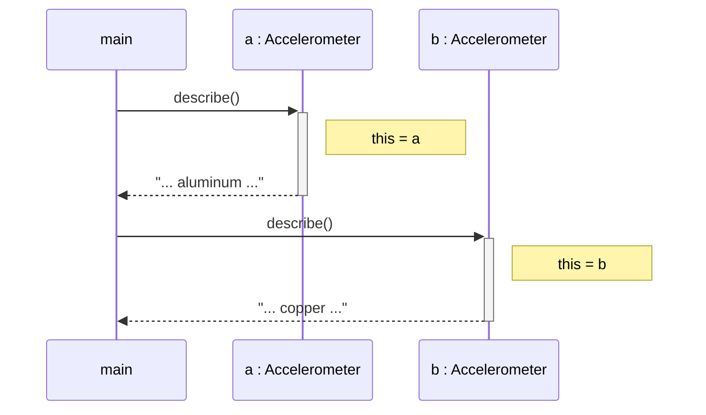
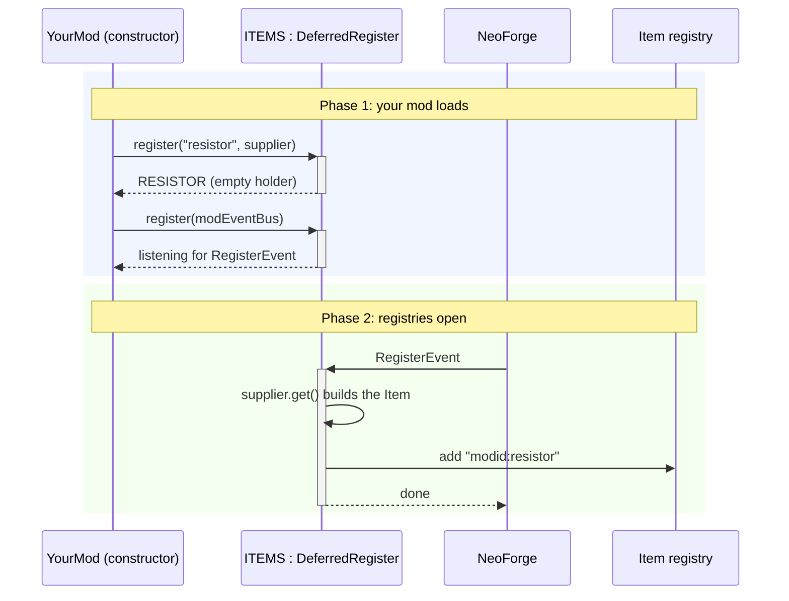

# Reference sheet

A growing set of standing references, so recall doesn't depend on memory alone. An entry is added when a concept is first taught, and each one says what it is, gives the smallest example, and links to where it was learned. The sheet is grouped by learning area. Diagrams follow `DIAGRAMS.md` (UML, drawn by Mermaid; GitHub draws them).

Entries are short on purpose. Recall quizzes still happen **without** this sheet; it's for looking things up while building.

---

## Java

### Class / object
- **Class:** a blueprint (`Accelerometer`). **Object:** one thing built from it (`new Accelerometer(...)`).
- Learned: session 01.

### Field / method / constructor
- **Field:** a value each object carries (`private double voltagein;`).
- **Method:** something an object can do (`describe()`).
- **Constructor:** runs on `new`, fills the fields; same name as the class, no return type.
- Learned: session 01.

### `extends` (inheritance)
- "**is a**"; exactly one parent. The subclass gets the parent's fields and methods.
- `super(...)` builds the parent's portion first; `super.method()` calls the parent's version.
- Learned: session 01.

### `@Override` / polymorphism
- A subclass **overrides** (doesn't overwrite) a parent method.
- **The object's real type decides which version runs**, not the variable's type. `@Override` is only a compiler check.
- Learned: session 01.

### `implements` (interfaces)
- "**can do**"; any number. An interface lists methods without bodies; the class supplies them.
- A parameter of an interface type accepts any class that implements it (`readMeter(VoltageOutput source)`).
- Learned: session 01.

### `this`
- **The object the method was called on.** In `b.describe()`, `this` is `b`.
- Think of it as a **hidden parameter**: you never write it in the brackets, but every call fills it in with the object left of the dot.
  ```
  b.setMaterial("titanium")
  │             └─ fills the parameter  material
  └─ fills the hidden parameter  this
  ```
- `this` is always an **object** (a thing with fields), never the method or an argument.
- Required only where a field and a parameter share a name (constructors, setters); elsewhere it's optional and usually left out.
- Static methods have no `this`.
- Learned: sessions 01–02 (a known beginner misconception).



### `private` / encapsulation / setter
- `private` = only code inside the class can touch it. Outside code goes through a method the class provides (`setRpmIn(500)`).
- The setter is where the part can react: validate, recalculate.
- Learned: session 01.

### `static`
- **One copy, owned by the class, shared by every object.** Called on the class: `Part.getPartsBuilt()`.
- No `this` inside a static method.
- Learned: session 01.

### Widening / narrowing
- `int` → `double` is automatic (nothing lost). `double` → `int` needs a cast: `(int) 2.7` gives `2` (cuts the decimals).
- Learned: session 01.

### Lambda / functional interface / `Supplier`
- A **lambda** is one method body written in place: `v -> v > 12`.
- It fits only an interface with **exactly one** method to fill (a **functional interface**).
- `Supplier<T>` (one method, `get()`) holds a **recipe**: `() -> new X(...)` builds nothing until `get()`; each call makes a new X. Checks belong to the caller (the coffee-machine button).
- Learned: session 01. **Standing review item.**

### `main` / calling methods
- A program starts at `public static void main(String[] args)`; a method only runs when called.
- Learned: session 01.

### Packages / `import`
- A package is a folder for classes (dots = folders). The `package` line comes first in the file; use `import` (Alt+Enter) for classes from other packages. Packages are lowercase by convention.
- Learned: session 01.

---

## NeoForge / Minecraft
Only the basic functions developers call are covered here. Minecraft's large internal systems (rendering, world generation, its maths) are mentioned by name only, never taught in depth.

### `@Mod` class
- The mod's entry point. NeoForge creates it at load; its constructor hooks things up.
- `@Mod(MODID)` must equal `mod_id` in `gradle.properties` (lowercase).
- Learned: session 01.

### `DeferredRegister` / registration
- Holds **recipes** (suppliers) and builds them when NeoForge opens the registries.
- Needs `ModItems.ITEMS.register(modEventBus)` in the constructor, or it never runs.


- Learned: session 01.

### assets vs data
- `assets/<modid>/` = what players see and hear (client): lang, models, textures.
- `data/<modid>/` = game rules (server): recipes, loot, tags.
- Learned: session 01.

### Events (NeoForge's hooks)
- NeoForge adds **hooks** at useful points inside Minecraft's own code and fires an **event** there; mods attach methods to them. The result goes into Minecraft's own process (integration, not a separate system).
- So far: `RegisterEvent` (registration) and `BuildCreativeModeTabContentsEvent` (fired once per creative tab; `event.getTabKey() == CreativeModeTabs.INGREDIENTS` picks the tab, `event.accept(ModItems.RESISTOR)` adds to it). Connected with `modEventBus.addListener(this::addCreative)`.
- Learned: session 03.

### Item appearance
- Lang key `item.<modid>.<name>`; model `models/item/<name>.json` (parent `item/generated`, `layer0` → `textures/item/<name>.png`).
- Checkered purple-black = a path mismatch.
- Learned: session 01.

---

## Gradle
- **`repositories`:** where libraries come from. **`dependencies`:** which ones are used (`group:artifact:version`).
- `${project.x}` reads `gradle.properties`.
- `api` vs `implementation` vs `compileOnly`.
- Learned: session 01 (Sable lesson 1).

## Power Grid (from its mod page)
- Circuits need loops; `V = I × R`; at a junction, current in = current out; higher voltage = less loss; production and demand must balance.
- Learned: session 01.
